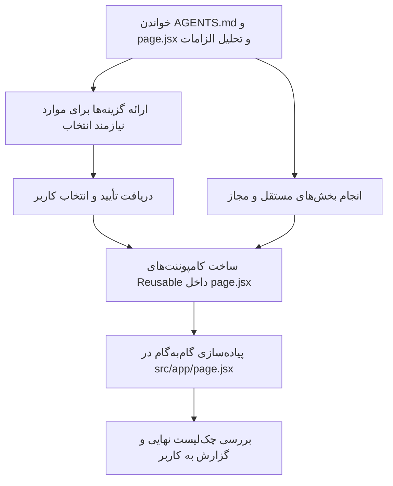

# دستورالعمل تسک Antigravity — بازطراحی و ارتقای UI/UX صفحه اصلی (نسخه ادغام‌شده)

> **راهنمای Agent:**
> این سند تنها دستورالعمل رسمی این تسک است. آن را **همراه با `AGENTS.md`** بخوان و تک‌تک بندهایش را به‌عنوان **قوانین قطعی (Hard Constraints)** در تمام مراحل این تسک و پیام‌های بعدی مربوط به آن رعایت کن. تغییرات یا جزئیات جدیدی که کاربر در ادامه گفتگو می‌دهد به همین تسک اضافه می‌شوند و باید با قوانین قبلی ترکیب شوند؛ تصمیم‌های قبلی را بدون دلیل تغییر نده.
> هر بخشی که در این سند «نیازمند انتخاب کاربر» علامت خورده، **نباید خودسرانه اجرا شود**.

### اولویت در صورت تعارض
1. دستور صریح و جدید کاربر در گفتگو
2. قوانین `AGENTS.md`
3. همین سند

اگر بین این سند و `AGENTS.md` یا دستور کاربر تعارض مستقیم دیدی، تعارض و پیامدهای هر انتخاب را کوتاه و واضح توضیح بده و **قبل از هر تغییر متعارض از کاربر بپرس**.

---

## ۱) شروع کار و بررسی اولیه

1. **پیش از هر تغییری، `AGENTS.md` را کامل بخوان** و قوانین مرتبط پروژه را مرور کن.
2. فایل `src/app/page.jsx` را **کامل** بخوان و این موارد را شناسایی کن: ساختار Sectionها، importها، تعریف داده‌ها، کلاس‌ها، منطق تم روشن/تاریک، `ScrollReveal`، استفاده‌های فعلی از Swiper و استفاده‌های `BiTargetLock`.
3. قبل از ویرایش، مشخص کن کدام تغییرات مستقیماً مجازند و کدام نیازمند تأیید کاربرند.
4. **دربارهٔ ساختار یا فیلدهای داده‌ای که هنوز بررسی نکرده‌ای حدس نزن.**

---

## ۲) محدودهٔ مجاز تغییرات (بسیار مهم)

1. **تنها فایل قابل تغییر `src/app/page.jsx` است.** هیچ فایل دیگری را ایجاد، حذف یا ویرایش نکن؛ شامل CSS، CSS Module، layoutها، componentهای جداگانه، داده‌ها، تنظیمات، `package.json`، lockfileها و تنظیمات پروژه.
2. **کامپوننت‌های Reusable** (مثلاً اسلایدر مشترک Section 4 و 7، یا المان تارگت `BiTargetLock`) را **داخل خود `page.jsx`** تعریف کن، نه در فایل جدا.
3. اگر برای کاری ناچار به تغییر فایل دیگری شدی، از محدوده عبور نکن؛ توضیح بده چرا `page.jsx` کافی نیست و **قبل از هر تغییر خارج از محدوده اجازه بگیر.**
4. تغییرات فقط در **Sectionهای ۲ تا ۷** مجازند.
5. **Section 1 کاملاً محافظت‌شده است:** JSX، ساختار، ترتیب، محتوا، کلاس‌ها، props، انیمیشن‌ها و ظاهر آن را تغییر نده. از تغییر والدها یا استایل‌های مشترکی که ناخواسته روی Section 1 اثر می‌گذارند نیز پرهیز کن.
6. Swiper از قبل نصب است؛ از همان استفاده کن و **پکیج جدیدی نصب نکن.** اگر API یا ماژول موردنیاز با نسخهٔ نصب‌شده سازگار نبود، ابتدا نسخه و الگوی موجود پروژه را بررسی کن.
7. **سرور توسعه را اجرا نکن**؛ کاربر خودش پروژه را اجرا و در مرورگر بررسی می‌کند. هیچ دستور دیگری هم نباید باعث تغییر فایل‌های خارج از محدوده شود.
8. فایل CSS جدید یا استایل سراسری نساز؛ از الگوی استایل‌دهی و ابزارهای موجود پروژه (مثلاً Tailwind) استفاده کن.
9. از نصب پکیج، تغییر تنظیمات پروژه و بازنویسی بخش‌های نامرتبط خودداری کن.

---

## ۳) روش تصمیم‌گیری و تعامل با کاربر

- هر Section را جداگانه بررسی کن و تغییراتش را با این سند تطبیق بده.
- **قانون توقف:** برای هر مورد «نیازمند انتخاب کاربر»، ابتدا ساختار و ظاهر فعلی را در کد بررسی کن، سپس **۲ تا ۴ گزینهٔ شماره‌گذاری‌شده** و متناسب با همان محتوا ارائه بده؛ برای هر گزینه **مزیت و عیب** را بگو، در پایان **پیشنهاد خودت را با دلیل** اعلام کن و **منتظر پاسخ کاربر بمان.** تا آن زمان آن بخش را پیاده‌سازی نکن.
- این توقف فقط مربوط به همان بخشِ نیازمند انتخاب است. بخش‌های مستقل و مجاز را می‌توانی انجام بدهی، به شرطی که پیاده‌سازی‌شان انتخاب کاربر را از پیش تحمیل نکند.
- بدون اجازهٔ کاربر تصمیم نگیر که عنصری حذف شود، طرحی کاملاً جدید جایگزین طرح فعلی شود یا سبک تصویری متفاوتی به کار برود.
- پیشنهادها باید بر اساس **کد و ظاهر واقعی همین پروژه** باشند، نه فهرستی عمومی. اثر هر پیشنهاد بر خوانایی، سلسله‌مراتب بصری، تعامل‌پذیری، واکنش‌گرایی و هماهنگی با تم روشن/تاریک را در نظر بگیر.

---

## ۴) قوانین کلی UI/UX (برای Sectionهای ۲ تا ۷)

1. **اولویت با ارتقای UI/UX:** تمام تغییرات باید مستقیماً خوانایی، تعامل‌پذیری، سلسله‌مراتب بصری و زیبایی را بهتر کنند.
2. **طرح فعلی کاربر نقطهٔ شروع است.** از صفر طراحی نکن؛ هویت بصری و مفهوم هر محتوا حفظ شود. ساختار تگ‌ها/کامپوننت‌ها فقط وقتی تغییر کند که واقعاً برای UI/UX، responsive بودن یا تعامل لازم است و فرم بصری مطلوب کاربر حفظ و صرفاً ارتقا یابد.
3. **واکنش‌گرایی کامل (Mobile / Tablet / Desktop):** اندازه فونت، فاصله‌ها (padding/margin)، عرض و ارتفاع باکس‌ها، `border-radius` و سایه‌ها باید در همهٔ اندازه‌ها هماهنگ باشند. از مقادیر افراطی یا هر چیزی که در صفحه‌های کوچک overflow ایجاد می‌کند پرهیز کن.
4. **پشتیبانی بی‌نقص از تم روشن و تاریک:** رنگ متن، پس‌زمینه، border، سایه، overlay، hover و focus را در هر دو تم بررسی کن. رنگی که در یک تم کنتراست ضعیف دارد استفاده نکن.
5. **`ScrollReveal`:** انتخاب محل و گروه‌بندی با توست. عناصر مرتبط را منطقی و یکپارچه wrap کن؛ لازم نیست هر عنصر جداگانه انیمیشن داشته باشد. از revealهای تودرتو یا تکراری که باعث پرش، تأخیر، لگ یا شلوغی می‌شوند پرهیز کن (اولویت: زیبایی بصری + پرفورمنس رندرینگ).
6. **انیمیشن‌ها شیک و مینیمال:** فقط حرکت ظریف و روان (Smooth & Subtle Micro-interactions) برای hover، ورود محتوا و تغییر اسلاید؛ نه افکت شلوغ، سنگین یا دائمیِ بی‌دلیل. حرکت نباید مانع خواندن متن شود.
7. **یکپارچه‌سازی `BiTargetLock`:** هر جا این آیکون یا بلوک‌های مشابه استفاده شده، استایل در سراسر صفحه یکدست شود. در صورت امکان یک کامپوننت Reusable (داخل `page.jsx`) بساز.
8. **لایه‌بندی تصاویر پس‌زمینه (z-index و overlay):** وقتی تصویر زیر متن است، ترتیب لایه‌ها طوری باشد که **تصویر کاملاً پشت متن** قرار گیرد و با گرادیان/overlay تیره یا روشن مناسب **هر دو تم**، متن ۱۰۰٪ خوانا باشد. تصویر نباید متن یا عناصر تعاملی را بپوشاند یا کلیک را مختل کند. زوم ملایم تصویر در hover مجاز و پیشنهادی است (`group-hover:scale-105 transition-transform duration-500`).
9. **دسترس‌پذیری:** hover، focus و تعامل با کیبورد را در نظر بگیر. برای paginationهای تصویری و عددی از کنترل‌های قابل دسترس، نام‌گذاری (`aria-label`) مناسب و وضعیت فعال واضح استفاده کن.
10. **داده‌ها را خودسرانه پر یا بازنویسی نکن.** شکل واقعی داده‌ها را از تعریف موجود در فایل بخوان و همان قرارداد را رعایت کن.
11. **آرایهٔ خالی:** اگر آرایهٔ یک اسلایدر خالی است، کد باید بدون خطا کار کند؛ داده نمونهٔ ساختگی اضافه نکن و رفتار امن (مثلاً رندر نکردن اسلایدر/pagination) در نظر بگیر.

---

## ۵) دستورالعمل هر Section

### Section 1
- **هیچ تغییری نده.** خارج از محدودهٔ تسک است.

---

### Section 2

**مجاز به اجرا**
- ظاهر عناصر `h2` را بهبود بده تا تیتری شاخص و گیرا شوند (رنگ، accent، گرادیان محدود یا جزئیات ظریف). خوانایی و هماهنگی با هر دو تم الزامی است.

**⛔ نیازمند انتخاب کاربر — فعلاً کدی نزن**
- هدف: باکس‌های `Section2DataP1` حس **سه‌بعدی (3D)** بدهند، اما فعلاً خود باکس‌ها را تغییر نده.
- پس از بررسی شکل فعلی، **حداقل ۳ پیشنهاد خلاقانه** ارائه بده (نمونه‌ها: عمق با سایه و highlight لایه‌ای، border و لبهٔ روشن، hover با بالا آمدن کنترل‌شده، perspective بسیار ظریف). پیشنهاد نهایی را با طراحی موجود تنظیم کن.
- مزیت/عیب هر گزینه + گزینهٔ پیشنهادی خودت را بگو و منتظر انتخاب کاربر بمان.

---

### Section 3
- تغییر ساختاری بزرگ نده؛ طرح و محتوای فعلی حفظ شود.
- تنظیم دقیق فاصله‌ها، تمایز تایپوگرافی، توازن بصری، بهبود تم، خوانایی در هر دو تم، انیمیشن ورود و استفادهٔ مناسب از `ScrollReveal` بر اساس استانداردهای مدرن UI/UX. از تغییر هویت بصری Section پرهیز کن.

---

### Section 4
این Section دو بخش دارد.

#### بخش اول
**مجاز به اجرا**
- اعمال قوانین کلی (ریسپانسیو، یکدست‌سازی، تم، ...) با حفظ طرح فعلی.

**⛔ نیازمند انتخاب کاربر**
- برای اعضای `Section4DataP1` پس از بررسی ظاهر فعلی، گزینه‌های مشخص بهبود ظاهری و چیدمان ارائه بده (مزایا/معایب + پیشنهاد خودت). تا انتخاب کاربر، ظاهر اختصاصی این باکس‌ها/اعضا را تغییر نده. این محدودیت نباید جلوی بهبودهای مستقل سایر قسمت‌های بخش اول را بگیرد.

#### بخش دوم — اسلایدر مبتنی بر Swiper

- با **Swiper نصب‌شدهٔ پروژه**، اسلایدر پیشرفته را بر پایهٔ `Section4DataP2` بساز.
- اسلایدر را به‌صورت **کامپوننت Reusable با props** (داخل `page.jsx`) پیاده کن تا Section 7 بخش اول هم از همان استفاده کند. این کامپوننت **الزامی** است تا از کد تکراری جلوگیری شود؛ محتوای هر اسلاید، `url` و تصویر باید فقط از همان عضو داده بیاید و اطلاعات دو اسلاید قاطی نشود.
- **نگاشت فیلدهای هر آبجکت** (قبل از پیاده‌سازی تعریف واقعی را در فایل بررسی کن و معنای فیلدها را تغییر نده):

| فیلد | کاربرد |
|---|---|
| `id` | مقدار `key` اسلاید |
| `head` | المان `p` برادر `h2` |
| `title1` | `span` با رنگ متمایز داخل `h2` |
| `title2` | ادامهٔ متن `h2` بعد از `title1` |
| `description` | پاراگراف توضیحی بعد از `h2` |
| `url` | آدرس اختصاصی دکمه/لینک **همان اسلاید** (نه لینک مشترک) |
| `image` | تصویر پس‌زمینهٔ همان اسلاید + منبع pagination تصویری دسکتاپ |

- تصویر هر اسلاید **پشت محتوای متنی** باشد و با overlay مناسب، متن در هر دو تم خوانا بماند.
- **Pagination تصویری عمودی:** فقط در دسکتاپ، سمت راست اسلایدر، از بالا به پایین؛ با کلیک روی هر تصویر، اسلاید مربوطه فعال شود. وضعیت فعال واضح باشد و تصاویر در اندازه‌های مختلف کنترل‌شده نمایش داده شوند.

**⛔ نیازمند انتخاب کاربر — pagination عددی را فعلاً حذف/تغییر نده**
- در پایین سمت چپ هر اسلاید، pagination عددی با ظاهر دایره‌ای وجود دارد. پیش از هر تغییر، وضعیت فعلی را بررسی کن و دو مسیر را با **استدلال و تحلیل UX** مقایسه کن:
  1. **حفظ و بهبود ظریف** pagination عددی (ظاهر، خوانایی، وضعیت فعال)
  2. **حذف** آن و تکیه بر pagination تصویری دسکتاپ / کنترل‌های مناسب دیگر
- بر اساس تعداد اسلایدها، وضوح وضعیت فعلی، موبایل در برابر دسکتاپ و شلوغی بصری، گزینهٔ پیشنهادی خودت را بگو و از کاربر انتخاب بگیر. تا آن زمان pagination عددی را حذف نکن؛ بخش‌های مستقل اسلایدر را می‌توانی آماده کنی.

---

### Section 5

#### نمای موبایل
- `h2` را با سبک عنوان‌های بهبودیافتهٔ سایر Sectionها یکسان کن.
- `description` را **وسط‌چین** کن و فاصله‌گذاری، اندازه و خوانایی‌اش را بهبود بده.
- ارتفاع تصاویر را responsive و متناسب با محتوای واقعی تنظیم کن.
- برای باکسی که متن روی تصویر دارد، **سایه/گرادیان/overlay** مناسب زیر متن قرار بده؛ تصویر پشت متن باشد.

#### نمای دسکتاپ
- **تصاویر:** ۴ تصویر **زیر هم، سمت راست.**
- **محتوا:** سمت چپ و **چپ‌چین**؛ استایل کلی مشابه موبایل.
- **Sticky Scrolling:** محتوای چپ تا زمانی که تصاویر Section در دید هستند همراه کاربر بماند (`sticky`)، اما از محدودهٔ مجموعهٔ تصاویر بیرون نزند.
- **قاعدهٔ تراز عمودی:** محتوا نباید پایین‌تر از آخرین تصویر برود؛ وقتی انتهای تصویر چهارم به حوالی وسط صفحه می‌رسد، انتهای باکس محتوا نیز دقیقاً در همان جایگاه (وسط) متوقف و تراز شود. پایان sticky باید به محدودهٔ والد/مجموعهٔ تصاویر مقید باشد.
- این رفتار را با ساختار واقعی DOM و ارتفاع محتوا تطبیق بده؛ از `position: sticky` فقط وقتی استفاده کن که در والدهای فعلی درست کار کند (مراقب `overflow` والدها باشد) و تداخل اسکرول ایجاد نکند.

**⛔ نیازمند انتخاب کاربر — افکت hover تصاویر را نهایی نکن**
- ایدهٔ اولیهٔ کاربر: هنگام hover، **border هماهنگ با تم/رنگ‌های سایت** ظاهر شود، **تصویر کمی زوم شود** و **متن هم حس hover را منتقل کند.**
- قبل از نهایی‌کردن، چند گزینه ارائه بده: گزینهٔ پیشنهادی کاربر + یک یا دو گزینهٔ ملایم‌تر/جایگزین، با تفاوت در شدت زوم، border، سایه، جابه‌جایی ظریف متن یا overlay، همراه با مزایا/معایب و پیشنهاد خودت؛ سپس منتظر انتخاب بمان.
- تا پیش از انتخاب، hover جدید را روی تصاویر پیاده نکن. layout دسکتاپ و رفتار sticky مستقل از این انتخاب قابل انجام‌اند.

---

### Section 6
- ساختار و منطق **کاملاً مشابه Section 5**، با یک تفاوت: در دسکتاپ **تصاویر سمت چپ** و **محتوای متنی چسبنده سمت راست** است.
- قواعد موبایل Section 5 (عنوان، description وسط‌چین، ارتفاع تصاویر، خوانایی متن روی تصویر) اینجا هم اعمال شود.
- در دسکتاپ، محتوای سمت راست هنگام اسکرول با مجموعهٔ تصاویر سمت چپ هم‌تراز بماند و از محدودهٔ عمودی آن‌ها خارج نشود (همان قاعدهٔ تراز عمودی Section 5).
- انتخاب hover تصاویر Section 5 به Section 6 نیز تعمیم داده می‌شود و ظاهر نهایی هر دو باید هماهنگ باشد (مگر کاربر بعداً تفاوتی بخواهد). بدون انتخاب کاربر، افکت نهایی را اعمال نکن.
- در صورت امکان، منطق مشترک Section 5 و 6 را در یک کامپوننت Reusable (داخل `page.jsx`) با prop برای جهت دسکتاپ پیاده کن.

---

### Section 7
این Section دو بخش دارد و هر بخش `ScrollReveal` مجزای خودش را دارد.

#### بخش اول — اسلایدر مشابه بخش دوم Section 4
- دقیقاً با ساختار و منطق بخش دوم Section 4 اسلایدر بساز، با منبع داده `Section7Data1`، و از **همان کامپوننت Reusable** Section 4 استفاده کن (تفاوت‌های محتوایی را hardcode نکن).
- قواعد تصویر پشت متن، overlay، pagination تصویری دسکتاپ، لینک اختصاصی هر اسلاید، دو تم و آرایهٔ خالی را مانند Section 4 رعایت کن.
- **⚠️ ابهام نام دیتا:** کاربر ظاهر این اسلایدر را مشابه بخش دوم Section 4 توصیف کرده، اما هنگام توضیح منبع به `Section4DataP1` اشاره کرده، در حالی که منبع بخش دوم Section 4 همان `Section4DataP2` است. **این دو را خودسرانه یکی فرض نکن.** تعریف واقعی `Section7Data1`، `Section4DataP1` و `Section4DataP2` را در فایل بررسی کن و از schema واقعی `Section7Data1` استفاده کن. اگر با فیلدهای موردنیاز اسلایدر تعارض دارد، پیش از اتصال اشتباه فیلدها **یک سؤال کوتاه و دقیق** از کاربر بپرس.
- تصمیم کاربر دربارهٔ pagination عددی Section 4 را بدون بررسی و تأیید جداگانه به این اسلایدر تعمیم نده؛ اگر حذف/تغییر آن اینجا هم لازم است، ابتدا بپرس انتخاب قبلی شامل این بخش می‌شود یا نه.

#### بخش دوم — اسلایدر نظرات و نقل‌قول (`Section7Data2`)

**موارد حفظ‌شدنی**
- آیکون `BiSolidQuoteAltRight` و ساختار/هویت فعلی آن را حفظ کن؛ مگر برای اصلاح responsive یا دسترس‌پذیری تغییر کوچکی ضروری باشد.
- ساختار واقعی آبجکت‌های `Section7Data2` (فیلدهای title/comment و آیکون‌ها) را از فایل بخوان و **نام فیلدها یا محتوا را حدس نزن.**

**نمای موبایل**
- `h2` در صورت نیاز **چندخطی و منظم** بشکند.
- اسلایدر **پیوسته و بدون توقف** (autoplay با سرعت ثابت یا افکت Marquee).
- **توقف** هنگام Touch/pointer press و Hover؛ پس از پایان تعامل، حرکت به‌صورت قابل پیش‌بینی ادامه یابد.
- دید: **۱ اسلاید کامل در مرکز + حاشیهٔ اندکی از اسلایدهای چپ و راست.**
- **جلوهٔ Fade / Vignette** در طرفین برای حس تاریکی و عمق؛ اسلاید مرکزی/فعال واضح‌تر باشد و اسلایدهای کناری به‌تدریج محو شوند. افکت نباید خوانایی متن اسلاید فعال را کم کند و باید در هر دو تم نتیجهٔ مناسب بدهد.
- **ساختار کارت:** باکس borderدار؛ بالا: آیکون اختصاصی کنار Title؛ زیر آن: Comment.

**نمای دسکتاپ**
- `h2` **حتماً در یک خط** (`whitespace-nowrap` یا کنترل اندازهٔ متن)، بدون بریدگی یا ناخوانایی؛ اندازه و فاصله‌ها با عرض صفحه سازگار باشند.
- ساختار کارت‌ها مشابه موبایل، با نمایش تعداد مناسب اسلاید همزمان (`slidesPerView`) که متناسب با **عرض واقعی viewport/کانتینر** باشد (breakpointهای Swiper)، نه یک عدد ثابت که در بعضی نمایشگرها باعث فشردگی یا فضای خالی شود.

**⛔ نیازمند انتخاب کاربر — ظاهر کارت‌ها و تعداد اسلایدها را قبل از اجرا تأیید بگیر**
1. **ظاهر کارت‌ها:** ۲ تا ۴ گزینهٔ بصری پیشنهاد بده و برای هر کدام توضیح بده: فرم border، پس‌زمینه، فاصلهٔ آیکون و عنوان، نحوهٔ نمایش comment، شدت محوشدن اسلایدهای کناری و میزان تأکید روی اسلاید فعال. یک گزینه را با دلیل پیشنهاد بده.
2. **تعداد اسلایدهای دسکتاپ (`slidesPerView`):** عدد پیشنهادی و دلیلش را بر اساس عرض کانتینر، طول title/comment و نیاز به برجسته‌بودن اسلاید فعال ارائه کن. نقطهٔ شروع: مقایسهٔ «یک اسلاید مرکزی + بخش‌هایی از اسلایدهای کناری» با «دو یا سه اسلاید کامل».
3. رفتار مناسب‌تر را برای **موبایل و دسکتاپ** جداگانه بگو و انتخاب کاربر را بگیر. تا آن زمان ظاهر نهایی کارت‌ها و تعداد اسلایدها را پیاده‌سازی نکن.

---

## ۶) چرخهٔ اجرای تسک

---

## ۷) فهرست موارد منتظر انتخاب کاربر (خلاصه)

| # | Section | موضوع |
|---|---|---|
| 1 | 2 | افکت ۳بعدی `Section2DataP1` (حداقل ۳ پیشنهاد) |
| 2 | 4 (بخش ۱) | بهبود ظاهری/چیدمان `Section4DataP1` |
| 3 | 4 (بخش ۲) | حفظ/حذف pagination عددی دایره‌ای + تحلیل UX |
| 4 | 5 و 6 | افکت hover تصاویر (علاوه بر border و scale) |
| 5 | 7 (بخش ۲) | ظاهر کارت‌های `Section7Data2` |
| 6 | 7 (بخش ۲) | تعداد اسلاید دسکتاپ (`slidesPerView`) |
| 7 | 7 (بخش ۱) | رفع ابهام `Section7Data1` در برابر `Section4DataP1/P2` (در صورت تعارض) |

---

## ۸) چک‌لیست نهایی (پیش از اعلام پایان)

- [ ] فقط `src/app/page.jsx` تغییر کرده و کامپوننت‌های Reusable داخل همین فایل‌اند.
- [ ] Section 1 از نظر کد و ظاهر دست‌نخورده است.
- [ ] تغییرات هر Section با این سند و انتخاب‌های ثبت‌شدهٔ کاربر مطابقت دارد.
- [ ] هیچ مورد نیازمند تأییدی بدون انتخاب کاربر تغییر تعیین‌کننده نکرده است.
- [ ] داده‌ی هر اسلاید درست به محتوای همان اسلاید وصل است؛ `id` به‌عنوان `key` و `url` فقط برای لینک همان محتوا.
- [ ] آرایه‌های خالی یا کم‌عضو باعث crash، خطای index یا pagination نامعتبر نمی‌شوند.
- [ ] هر دو تم روشن و تاریک بررسی شده و متن روی تصاویر کاملاً خواناست.
- [ ] در موبایل، تبلت و دسکتاپ: بدون overflow افقی، بریدگی متن، ابعاد نامناسب یا تداخل sticky.
- [ ] استایل `BiTargetLock` در سراسر صفحه یکدست است.
- [ ] hover، focus و انیمیشن‌ها ظریف، روان و سازگار با عملکرد اصلی‌اند.
- [ ] `ScrollReveal` گروهی و بدون revealهای تودرتوی آزاردهنده استفاده شده است.
- [ ] هیچ پکیج یا فایل دیگری تغییر نکرده و سرور توسعه اجرا نشده است.

**گزارش‌دهی:** پس از پایان هر مرحله شفاف بگو چه چیزهایی تغییر کرده، کدام انتخاب‌ها هنوز منتظر تأیید کاربرند و آیا محدودیتی وجود داشته است. **ادعای تست بصری یا اجرای پروژه نکن، مگر اینکه واقعاً انجام شده باشد.**
